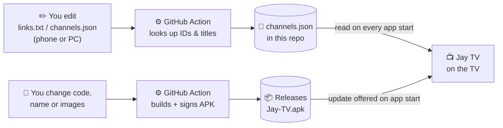

<div align="center">

# 📺 Jay TV

**A kid-safe YouTube player for Android TV.**
Only the channels, songs and scenes *you* pick. No search. No recommendations. No rabbit holes.

[](../../actions)
[](#-requirements)
[](https://github.com/yuliskov/SmartTube)
[](LICENSE)

</div>

---

## 🙏 Credits

Jay TV is a modified version of **[SmartTube](https://github.com/yuliskov/SmartTube)** by **[yuliskov](https://github.com/yuliskov)** and its contributors.
All the hard work of talking to YouTube and playing video on Android TV is theirs, so please support the original project.
SmartTube is released under the MIT License; its license and copyright notice are kept in [LICENSE](LICENSE).
This project is not affiliated with or endorsed by SmartTube's author or by YouTube.

---

## ✨ What it does

| | |
|---|---|
| 🔒 **Locked down** | No search (text or voice), no Home / Trending / Subscriptions, no related videos, no autoplay into random videos |
| 🎵 **Songs** | A row of single videos you chose. They play one after another and loop |
| 🎬 **Scenes** | A second row of single videos, same idea, kept separate from songs |
| 📡 **Channels** | One sidebar entry per allowed channel, showing its uploads |
| 🛡️ **Double-checked** | A video plays only if its channel or video ID is on your list. It is checked again once YouTube reports the real channel |
| ☁️ **Edit from your phone** | Change the lists on github.com (or with a Run-workflow form). The TV reads them at every app start. **No rebuild** |
| 🔄 **Self-updating** | Code / name / icon changes build a signed APK on GitHub; the TV offers the update when it opens |
| 🎨 **Your look** | Own name, icon and TV banner (a bright JAY set is included) |

---

## 🧭 How it works



Two separate paths:

1. **Content** (what is shown) → `links.txt` / `channels.json` → live on the TV after an app restart. **No new APK.**
2. **App** (code, name, icon) → push to GitHub → new APK → the TV offers the update → press **Install**.

---

## ✅ What is already built

- [x] Fork of SmartTube trimmed to channels, songs and scenes only
- [x] Search removed everywhere (text, voice, global search, deep links); long-press menus disabled
- [x] Playback allow-list (channel ID or video ID), checked before and after the video loads
- [x] Songs and Scenes sections that loop inside their own list
- [x] Lists live in `channels.json`; cached on the TV for offline use; bundled copy as last fallback
- [x] `links.txt` → `channels.json` automation (**adds** to the list, never overwrites it)
- [x] "Run workflow" form with a dropdown: **song / scene / channel**
- [x] Branding folder (name, icon, banner, in-app logo for every colour theme)
- [x] GitHub Actions build with your own signing key and automatic Releases
- [x] In-app update from your Releases
- [x] Built on SmartTube's no-analytics (F-Droid) flavor, app id `app.kidtube.tv`

---

## 🚀 Setup (one time)

**You need on your PC:** Git, JDK 17, [GitHub CLI](https://cli.github.com) (`gh auth login`), Android platform-tools (`adb`).
Python is only needed for local builds; GitHub has its own.

1. **Fork** [SmartTube](https://github.com/yuliskov/SmartTube) and clone your fork with sub-projects:
   `git clone --recurse-submodules https://github.com/<you>/<repo>.git`
2. **Apply the Jay TV changes** (copy the project files over your clone, then commit).
3. **Create your signing key** (one command, creates the 4 GitHub secrets for you):
   - Windows: `powershell -ExecutionPolicy Bypass -File scripts\setup-signing.ps1`
   - Mac/Linux: `bash scripts/setup-signing.sh`

   > ⚠️ **Back up `kidtube.jks` and `kidtube-passwords.txt`** (cloud drive / pen drive).
   > Lose them and you can never update the installed app: you would have to uninstall and reinstall.
   > They are git-ignored and never uploaded.
4. **Push.** In the **[Actions](../../actions)** tab "Build Jay TV APK" runs (10–20 min the first time).
   When it is green, **[Releases](../../releases)** has `Jay-TV.apk`.
5. **Prepare the TV:** Settings → Device Preferences → About → click **Build** 7 times → Developer options → turn on **USB debugging**.
   Note the TV's IP (Settings → Network). PC and TV on the same Wi-Fi.
6. **Install once:** `scripts\install-to-tv.ps1 -TvIp <TV_IP>` (Windows) or `bash scripts/install-to-tv.sh <TV_IP>`.
7. **Lock settings:** in the app open Settings → General → **Protect all settings with password** and set a PIN. Do this straight away.

After that you never need a cable again; updates arrive inside the app.

---

## 📚 Managing what is shown

### `channels.json` — the list the TV reads

```json
{
  "version": 1,
  "channels": [ { "name": "Some Channel", "id": "UCxxxxxxxxxxxxxxxxxxxxxx" } ],
  "songs":    [ { "title": "A song",  "id": "XXXXXXXXXXX" } ],
  "scenes":   [ { "title": "A scene", "id": "YYYYYYYYYYY" } ]
}
```

| Section | `id` is | Shows as |
|---|---|---|
| `channels` | channel ID, starts with `UC`, 24 characters | one sidebar entry per channel (its uploads) |
| `songs` | video ID, 11 characters (after `v=` in a video link) | the **Songs** row, plays in order, loops |
| `scenes` | video ID, 11 characters | the **Scenes** row, plays in order, loops |

- Rows with placeholder or malformed IDs are ignored. The `name` key works instead of `title` too.
- If the file is invalid JSON (a missing comma, for example), the TV keeps using the **last good copy**.
- GitHub caches the raw file for about 5 minutes; after that, restart the app to see changes.
- You can edit this file by hand at any time. Nothing overwrites it.

### `links.txt` — paste links, IDs are looked up for you

Put **links**, not IDs. A GitHub Action finds the IDs and titles and **adds** them to `channels.json`.

**Where a link goes:** a header line, and everything below it goes there.

```text
[songs]
https://www.youtube.com/watch?v=XXXXXXXXXXX

[scenes]
https://youtu.be/YYYYYYYYYYY
Beach day | https://youtu.be/ZZZZZZZZZZZ

[channels]
https://www.youtube.com/@SomeChannel
https://www.youtube.com/channel/UCxxxxxxxxxxxxxxxxxxxxxx
```

**Or choose on each line with a prefix** (wins over the header above it):
`song: <link>` · `scene: <link>` · `channel: <link>`
**Custom name:** `scene: Beach day | <link>`
**No header, no prefix:** a video link becomes a song, anything else becomes a channel.

How it behaves:

| Rule | Detail |
|---|---|
| ➕ Adds only | Everything already in `channels.json` is kept. New items go **on top** of their list (newest first). Prefer them at the bottom? Set `NEWEST_FIRST = False` in `scripts/links_to_json.py` |
| ♻️ No duplicates | A link already added is skipped. Adding a custom name to an existing link renames it |
| 🗑️ Removing | Delete the entry in `channels.json` (deleting the line in `links.txt` does nothing) |
| ❌ Wrong place | A channel link under `[songs]` (or a video link under `[channels]`) is skipped with a clear reason in the Action's summary |
| 🛟 Safe | If nothing can be resolved, `channels.json` is left untouched |

### Three ways to add things

1. **Edit `links.txt` on github.com** (works in a phone browser or the GitHub app) and commit.
2. **Run workflow form:** [Actions](../../actions) → **Update channels from links** → **Run workflow** → pick **song / scene / channel**, paste the link, optional name.
3. **Edit `channels.json` directly** if you already have the IDs.

You never need to `git pull` for any of this. The Action commits to GitHub and the TV reads it from there.
(Only if you also edit files on your PC: run `git pull --rebase --autostash` before your next `git push`.)

---

## 🎛️ What you can change

| I want to change… | Where | Rebuild + TV update? |
|---|---|---|
| Channels, songs, scenes | `links.txt` or `channels.json` | **No** (restart the app) |
| App name (also names the APK: `Jay TV` → `Jay-TV.apk`) | `branding/app_name.txt` | Yes |
| App icon | `branding/icon.png` (square, 512 px or bigger) | Yes |
| TV home-screen banner | `branding/banner.png` (16:9, 1280×720) | Yes |
| In-app logo (top right) | `branding/logo.png` (optional; otherwise the icon is used) | Yes |
| Colour theme | In the app: Settings → *Color scheme* (Teal, Dark Grey, Red, Dark Blue, OLED variants). All are dark; there is no light theme | No |
| Allow videos whose channel can't be determined up-front | `ALLOW_UNKNOWN_CHANNEL` in `AllowList.java` (`false` = stricter) | Yes |
| Turn the whole lockdown off (back to a full SmartTube) | `LOCKDOWN` in `AllowList.java` | Yes |
| Section names / icons ("Songs", "Scenes") | `initAllowListSections()` in `BrowsePresenter.java` | Yes |

Images only need to be dropped into `branding/` (upload on github.com, same file name). `scripts/apply_branding.py` resizes them and puts them in the right places during the build; you never type paths.

> 💡 The launcher name and icons are baked into the APK, so they change only through an update. The TV offers it automatically after the build finishes. The release file is named after `branding/app_name.txt` (spaces become dashes).

**Please don't change** these, or updates and installs will break:
`app.kidtube.tv` (the app id), the signing key / secrets, and the manifest name `kidtube.json` (already-installed apps look for it).

---

## 🌗 Dark / light theme

Jay TV keeps SmartTube's built-in colour schemes: **Teal, Dark Grey, Red, Dark Blue** and **OLED** versions of them.
All of them are dark, which is the right choice for a TV in a living room. A true *light* theme would mean restyling
every screen, so it is not included. To change the look today: open the app → Settings → **Color scheme**.
The small JAY logo in the top-right corner is shown in every scheme.

---

## 🔄 Updating the app

1. Change code, `branding/…`, or run the **Build Jay TV APK** workflow manually from the Actions tab.
2. Wait for the green tick; `Jay-TV.apk` appears under **[Releases](../../releases)**.
3. Open Jay TV on the TV. It offers the update. Press **Install**.

Changes to only `channels.json`, `links.txt` or `*.md` files **don't** trigger a build.

To pull in SmartTube's own fixes (YouTube breaks third-party apps now and then):
```bash
git remote add upstream https://github.com/yuliskov/SmartTube.git
git fetch upstream && git merge upstream/master
```

---

## 🛠️ Troubleshooting

| Problem | Try |
|---|---|
| New channel/song doesn't show | Wait ~5 min, restart the app. Check the **Update channels from links** run in Actions and its summary |
| Action says a link failed | Open the run → *Summary*; it names the line and the reason. For a channel use the `youtube.com/channel/UC…` link |
| Song/scene won't play | Some videos (e.g. certain official music videos) can't be played by third-party apps; try another upload |
| Build is red | Open the failed step, copy the red lines, fix or ask your coding agent |
| `git push` rejected | `git pull --rebase --autostash`, then `git push` |
| Old icon/name after an update | Restart the TV |
| `adb` can't connect | Same Wi-Fi? USB debugging on? Accept the prompt on the TV; re-run `adb connect <ip>:5555` |

---

## 🔐 Safety notes

- Set the **settings password** (step 7 above), or a child can open Settings and change things.
- Build and sign your **own** APK from this source; never install SmartTube APKs from random websites.
  (SmartTube's author has published a notice that some of *his* past releases may have been affected by malware on his machine.
  Your builds come from source on GitHub's servers, signed with your own key.)
- Videos opened from outside the app (casting, deep links) have no channel until YouTube reports it, so they start and are then closed. Set `ALLOW_UNKNOWN_CHANNEL = false` to block them up front.
- Third-party YouTube clients go against YouTube's terms. This is meant for private, personal, home use.

---

## 🗂️ Project layout

```text
channels.json                 the live list the TV reads
links.txt                     paste links here (how-to is written as # comments at the top of the file)
branding/                     app_name.txt, icon.png, banner.png, logo.png
scripts/
  links_to_json.py            links.txt -> channels.json (merge)
  apply_branding.py           resizes images + writes the app name before each build
  setup-signing.(ps1|sh)      one-time signing key + GitHub secrets
  install-to-tv.(ps1|sh)      first install over the network (adb)
.github/workflows/
  build.yml                   builds the signed APK and publishes the Release
  update-channels.yml         turns links into channels.json (push on links.txt or Run-workflow form)
common/…/AllowList.java       the allow-list brain (parsing, caching, checks)
```

---

## 📄 License

MIT, same as SmartTube. See [LICENSE](LICENSE).
